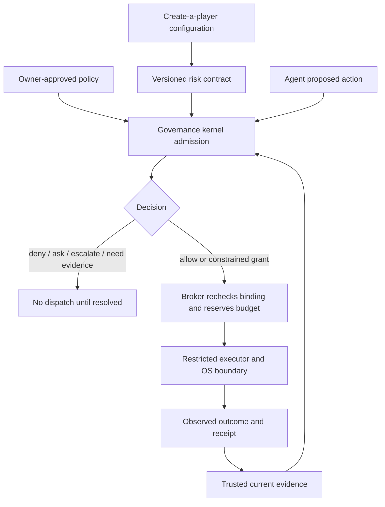

# How the risk contract links to the kernel

2026-10-03 · proposed articulation and integration map · not a deployed connection.

> The risk contract defines the operating envelope of an agent and its attachments. The governance kernel evaluates each proposed action against that envelope and the owner's authority. Constrained executors enforce the resulting limits; runtime evidence determines whether the conditions for continued operation still hold.

Short form: **The contract states the limits. The kernel checks admission. The execution boundary enforces the limits. Receipts and observations make the result inspectable.**

Here “kernel” means the HUMMBL governance/admission function, not the Windows kernel or the model's reasoning procedure. Local repositories also use kernel for orchestration and reasoning. This map targets `hummbl-governance-kernel` (HGK); it does not merge those implementations or assume either is currently deployed around nakedagent.

## Relationship to existing architecture

The Constitution in C design already separates owner-approved policy, deterministic evaluation, a local broker, restricted workers, narrowly scoped executors and outcome evidence. The risk contract supplies run- and composition-specific conditions within that design. It neither replaces the constitution nor gives an agent authority to amend it.

| Layer | Role in this integration |
|---|---|
| Reuben / owner policy | Defines permissible authority, purposes and limits; grants or revokes delegated authority |
| Risk contract | Binds this run, foundation and attachments to resources, data flows, controls, budgets, expiry and failure behavior |
| Hexad / Decide-0 | Helps form proposals, identify scenarios and supply advisory judgments; never creates a grant |
| Governance kernel | Checks a typed action against owner policy, contract binding, composition and trusted current evidence |
| Broker / OS / executor | Makes approved effects possible only within the checked boundary; prevents alternate routes |
| Observations / receipts | Distinguish decisions, attempts and observed outcomes, and trigger reassessment |
| Create-a-player UI | Authors a candidate configuration, previews the contract delta and displays evidence; has no independent authority |

`constrain` requires an enforceable reduced grant; merely returning that word is not permission to run the original action. Owner authorization persists within its valid scope; the kernel need not ask again for every already-authorized action. Freshness checks and scope checks do not create another approver over the owner.

## Admission invariant

For each mediated effect, require:

`valid owner delegation AND exact contract/artifact/config binding AND effect within permitted composed scope AND verified required controls AND fresh required evidence AND available reserved budget`.

If authority/policy prohibits the action, deny it. If required facts are missing or stale, use the existing evidence/hold route. If a smaller permitted action exists, return constraints that the executor can actually enforce. Never translate an unknown risk estimate into authorization.

Admission happens before plugin import, child launch, credential release and network request—not only before a model-selected tool call. Continued authority is conditional: provider drift, plugin changes, revoked credentials or failed controls invalidate affected leases. Recheck at dispatch and on relevant runtime changes. Account for actions already in flight and irreversible effects.

The kernel and broker are themselves part of the trusted dependency set: their artifacts, dependencies, policy store, signing/receipt keys, OS identity, update path, recovery path and failure modes need contracts too. This recursion ends in an explicitly named trusted computing base and owner recovery authority; it does not provide an infinite proof of trust or permit kernel self-authorization.

## Concrete HGK mapping and observed gaps

Inspected HGK HEAD: `4e7a06359eae81b3c48f2a57cd82c5fca7e0bf40`.

- `src/gateway/action_gateway.py:process_proposal()` validates/adapts a proposal and calls `process_action()`. This is the candidate ingress seam.
- `process_action()` normalizes, optionally checks handoff scope and authority locking, classifies, and returns decision/receipt metadata. Its code explicitly makes parts of enforcement opt-in. It does not establish universal mediation of nakedagent's effects.
- `schemas/policy_decision.schema.json` already names `allow`, `ask`, `deny`, `constrain`, `escalate`, and `require_more_evidence`, with `required_controls`, `policy_version` and `enforcement_status`. Preserve these distinctions; don't introduce a second incompatible decision vocabulary.
- `src/gateway/proposal_adapter.py:proposal_to_action()` selects a limited set of proposal fields. Adding contract/evidence fields to a proposal alone would not ensure they reach classification or dispatch. An integration needs validated propagation and tests across the whole path. Its rejection of proposer-supplied gateway freshness fields is a useful existing separation.
- That adapter imports `jsonschema`. Directly importing HGK into nakedagent would add a third-party dependency. Keep the nakedagent boundary stdlib-only; review a local broker/IPC adapter and its separately inventoried dependencies instead. No transport or service has been installed here.
- nakedagent's ordinary `loop.py:step()` dispatches registered tools directly. Its functional driver and sidekick have separate execution paths. All admitted paths, including plugin startup, would need mediation or exclusion from the contained profile. A receipt-enabled path alone is insufficient.

Proposed integration payload (field names are draft, not existing HGK schema): immutable references/digests for risk contract, dependency graph, effective configuration, evidence snapshot and owner policy; plus run/action identity. The trusted boundary resolves and validates references. An attacker-controlled path or self-reported digest cannot establish trust.

Minimum integration demonstration: an action within the envelope executes through a constrained adapter; a prohibited action cannot execute; attaching a new plugin or changing the provider invalidates the old grant; stale evidence holds dispatch; all outcomes bind the same run/action/contract revision. Test direct bypass attempts, not just correct calls to the gateway.

## Sources and status

- `C:/Users/Owner/PROJECTS/hummbl-governance-kernel/README.md`, `docs/action-gateway.md`, gateway code and policy-decision schema inspected locally.
- `C:/Users/Owner/.agents/docs/architecture/constitution-in-c.md`: design proposal, not proof of deployment.
- `C:/Users/Owner/PROJECTS/kernel/README.md`: separate Mission Mode orchestration project; its descriptive claims were not validated as runtime guarantees.

At the initial design milestone, neither the contract nor the scenario dashboard was wired into a kernel. The subsequent [bounded pilot](PILOT-RESULTS.md) now exercises actual HGK action decisions for a fixed public-fixture read with synthetic authority/evidence. The production agent and dashboard remain unconnected; full mediation is still an open implementation obligation.
